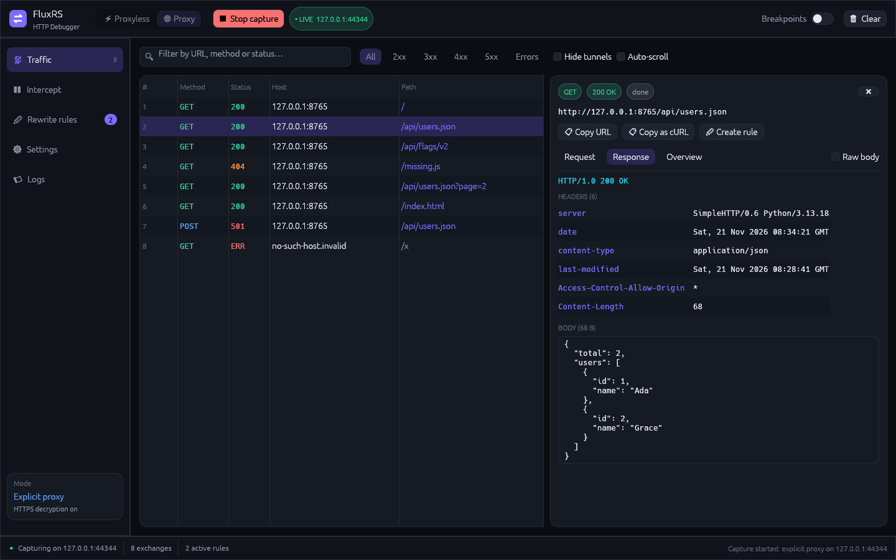
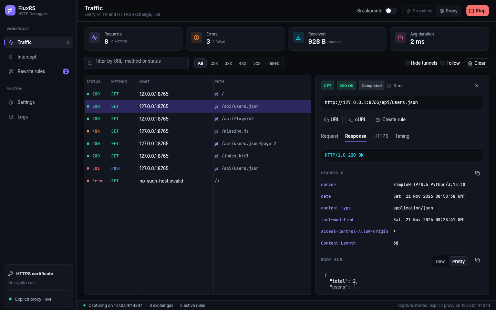
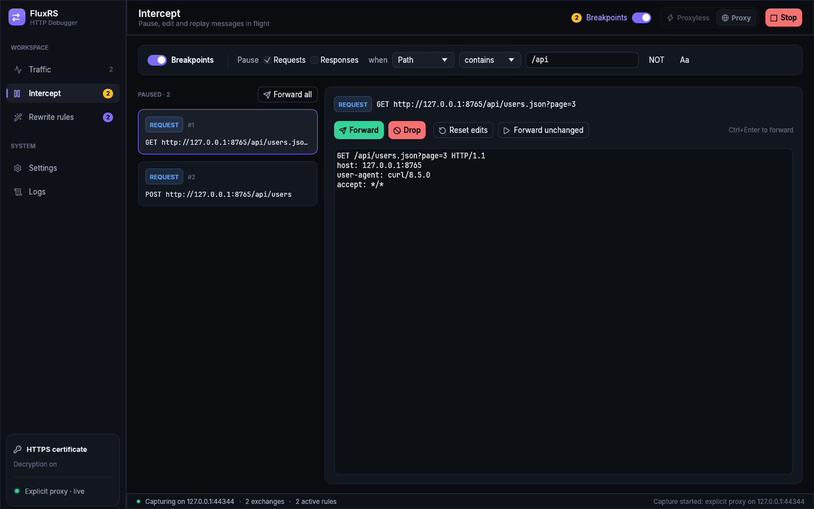
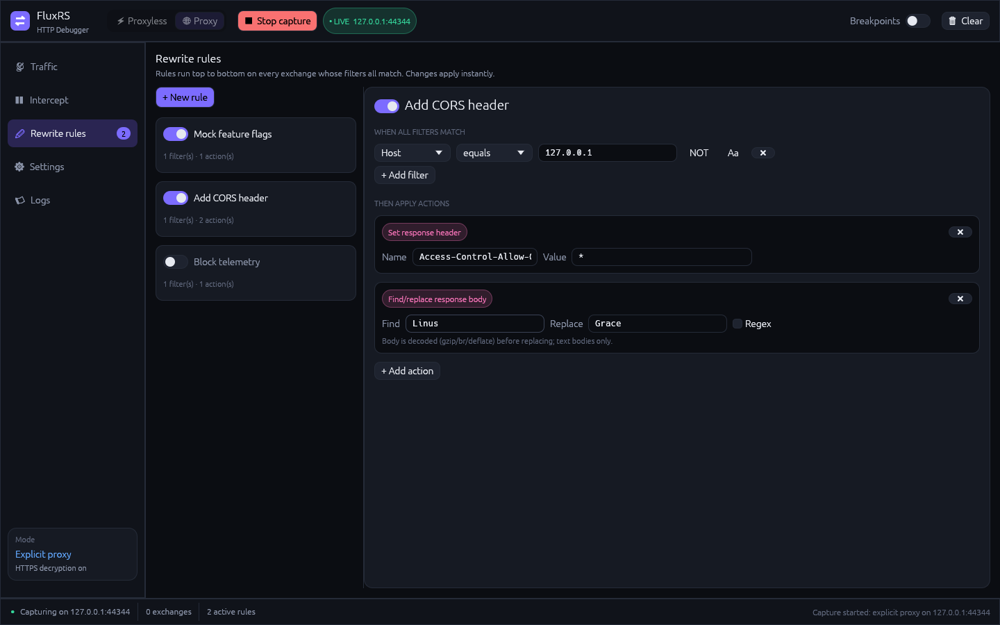
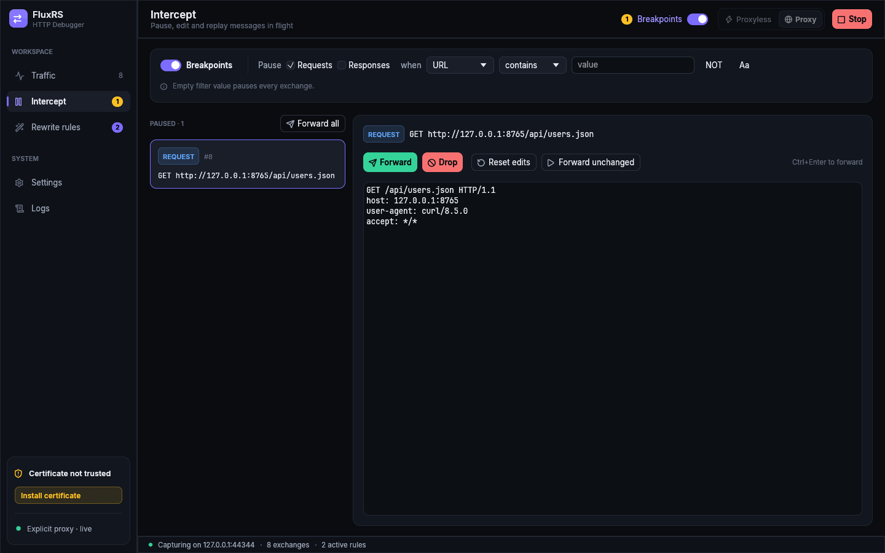

# FluxRS — proxyless HTTP debugger for Windows and Linux

FluxRS is an HTTP/HTTPS debugger written in Rust, both the engine and the
GUI. It can capture traffic **without any proxy configuration**: on
Windows the WinDivert driver redirects outgoing HTTP/HTTPS connections into
the built-in MITM engine.

The engine (`crates/fluxrs-core`) is a Rust re-implementation of the main
ideas of [fluxzy.core](https://github.com/haga-rak/fluxzy.core):
on-the-fly certificates, filters and actions, breakpoints, and transparent
capture.



## Features

| | |
|---|---|
| **Proxyless capture** | WinDivert redirects outbound TCP 80/443 to the engine, so every app (browser, CLI, desktop) is captured with no proxy settings. QUIC (UDP 443) is blocked during capture so browsers fall back to TCP. |
| **Explicit proxy mode** | Classic HTTP proxy (`127.0.0.1:44344` by default) with `CONNECT` support, for other OSes or devices. |
| **HTTPS decryption** | Local root CA (ECDSA P-256) with leaf certificates generated per host and cached. One-click install into the Windows trust store. Host bypass list for certificate-pinned apps. |
| **Intercept (breakpoints)** | Pause requests and/or responses that match a filter, edit them as raw HTTP text, then forward, forward unchanged, or drop. |
| **Rewrite rules** | Filters (URL / host / path / method / header × contains / equals / starts / ends / regex, NOT, case) + actions: set/remove headers, method, path regex rewrite, redirect to another host, replace or find/replace bodies (gzip/br/deflate are decoded first), status, mock response, block, delay. Changes apply live. |
| **HTTPS inspector** | TLS version and cipher for both legs (client ⇄ FluxRS, FluxRS ⇄ server), SNI/ALPN, and the real server certificate (subject, issuer, validity, SANs). The app checks whether the root CA is trusted and offers a one-click install. |
| **Inspector** | Request/response headers, decoded and pretty-printed bodies, hex view for binary bodies, timings, copy as cURL, create a rule from an exchange. WebSocket upgrades are tunneled. |





## Platforms

| Platform | Explicit proxy | Proxyless capture | HTTPS CA install | Package |
|---|---|---|---|---|
| Windows 10 / 11 x64 | yes | WinDivert (Administrator) | Windows trust store | zip |
| Ubuntu 22.04+ (and other Linux desktops) | yes | iptables `REDIRECT` (asks for admin through pkexec) | system store + Chrome NSS | `.deb`, tar.gz |
| Windows 7 SP1 x64 | experimental | experimental (WinDivert 2.2 supports Win7) | Windows trust store | zip (`windows7-experimental`) |

Windows 7: stable Rust supports Windows 10 and later only. The Windows 7 build
uses the tier-3 target `x86_64-win7-windows-msvc` (nightly, `build-std`). It is
built by the Build workflow but has not been tested on a Windows 7 machine.
Windows 7 also needs the SHA-2 code-signing update (KB4474419) to load WinDivert,
and an OpenGL 2 capable GPU driver.

## Download and run (Windows)

1. Download the `FluxRS-…-windows-x64` artifact from the **Build** workflow
   (Actions → Build → Run workflow), or build it yourself (see below).
2. Keep `fluxrs.exe`, `WinDivert.dll` and `WinDivert64.sys` in the same folder.
3. Start `fluxrs.exe`. It asks for Administrator rights, which loading the
   WinDivert driver requires.
4. **Settings → Install certificate** adds the root CA to the Windows trust store once.
   Firefox uses its own store: import `fluxrs-root-ca.crt` there or enable
   `security.enterprise_roots.enabled`.
5. Press **Start capture**.

Data (CA, `settings.json`, `rules.json`) lives in `%APPDATA%\FluxRS` on Windows and
`~/.local/share/FluxRS` on Linux.

Command-line flags: `--start` starts capturing at launch;
`--view traffic|intercept|rules|settings|logs` opens that page.

## Download and run (Ubuntu / Linux)

1. Download the `FluxRS-…-linux-x64` artifact from the **Build** workflow.
2. Install the package and start FluxRS from the app menu:
   ```bash
   sudo apt install ./fluxrs_*.deb
   ```
3. **Settings → Install certificate** copies the root CA to
   `/usr/local/share/ca-certificates`, runs `update-ca-certificates` (password
   prompt) and adds it to Chrome's NSS store when `libnss3-tools` is installed.
   Firefox: import the file under Settings › Certificates.
4. Choose **Proxyless** and press **Start capture**. FluxRS asks for the admin
   password once to add iptables rules, and once more to remove them on stop.

Proxyless on Linux redirects outgoing TCP 80/443 (IPv4) to FluxRS with
iptables. FluxRS reads the real destination with `SO_ORIGINAL_DST`, and its own
upstream connections use source ports 61000–61999, which the rules skip. The
rules sit in their own chains (`FLUXRS`, `FLUXRS_FILTER`) and are removed on
stop, on Ctrl+C or `kill`, and after a crash. If a session is killed with
`kill -9` or the machine loses power, remove them with:

```bash
fluxrs --cleanup
```

## Browser UI (WebAssembly)

The same egui interface also runs in a browser, compiled to WebAssembly. The
capture engine cannot run inside a browser (no raw sockets, no WinDivert or
iptables), so it runs headless on a machine and the browser connects to it:

```bash
fluxrs --serve
```

It prints a link like `http://127.0.0.1:8800/#token=…`. Open it in any modern
browser. Options:

* `--listen 0.0.0.0:8800`: reachable from other devices on the LAN (use the
  machine's IP address in the link). Only do this on a trusted network.
* `--token <secret>`: fixed token instead of a random one.
* `--web-root <dir>`: location of the web files (default: `web/` next to the
  executable, or `/usr/share/fluxrs/web` from the `.deb`).



The browser talks to the engine over a WebSocket (`/ws`, JSON messages from
`crates/fluxrs-model/src/protocol.rs`). Every connection needs the token.
`/ca.crt` serves the root certificate, so other devices can download and
trust it. Bodies larger than 1 MB are truncated before they are sent to the
browser. Stop the server with Ctrl+C: capture stops and proxyless rules are
removed.

Build the web files yourself:

```bash
rustup target add wasm32-unknown-unknown
```

```bash
cargo install wasm-bindgen-cli --version 0.2.130 --locked
```

```bash
crates/fluxrs-app/web/build.sh
```

The version must match `wasm-bindgen` in `Cargo.lock`. The output goes to
`crates/fluxrs-app/web/dist`. Release packages already contain it in `web/`.

## Limitations

* Only HTTP/1.1 is used between clients and FluxRS (ALPN offers only
  `http/1.1`). HTTP/2 and HTTP/3 are not decoded.
* Proxyless mode redirects IPv4 on ports 80 and 443. New IPv6 connections
  to those ports are dropped, so clients fall back to IPv4.
* Apps that pin certificates fail the TLS handshake. Add their hosts to
  **Settings → Never decrypt**.
* WinDivert needs a 64-bit Windows that can load signed kernel drivers.
  Some anti-cheat and security tools block it.

## How proxyless capture works (Windows)

```
app A:p ──SYN──▶ S:443          (outbound, captured by WinDivert)
        rewritten to  S:p ──▶ A:44344   (re-injected as inbound)
FluxRS accepts a connection from "S:p" → knows the real server S,
looks up the original port (443) in the NAT table, decrypts with a
forged certificate for the SNI, forwards to S:443 from its own socket
(that socket's port is marked "owned" so it is never redirected).
replies A:44344 ──▶ S:p  are rewritten back to  S:443 ──▶ A:p
```

The packet logic is in `crates/fluxrs-core/src/nat.rs`. It is pure Rust
and unit tested. `divert.rs` loads `WinDivert.dll` at runtime, so building
does not need the WinDivert SDK.

## Build from source

Requires the stable Rust toolchain.

```bash
cargo test --workspace
```

```bash
cargo build --release -p fluxrs-app
```

The binary is `target/release/fluxrs.exe`. For proxyless mode, copy
`WinDivert.dll` and `WinDivert64.sys` (x64 folder of
[WinDivert 2.2.2](https://github.com/basil00/WinDivert/releases/tag/v2.2.2))
next to it.

## Project layout

```
crates/fluxrs-model  shared data model + UI/host protocol (serde, also compiles to wasm)
crates/fluxrs-core   engine: proxy, TLS MITM, certificates, rules, intercept, WinDivert, iptables
crates/fluxrs-app    egui UI (desktop + wasm), host, `--serve` web server
.github/workflows    ci.yml (fmt, clippy, tests on every push), build.yml (manual release build)
```

## CI

* **CI** (`ci.yml`) runs on every push and pull request: `cargo fmt`,
  `clippy -D warnings` and every test on Windows, plus core tests on Linux.
* **Build** (`build.yml`) is started manually from the Actions tab
  (*Run workflow*). It tests, builds the release exe, downloads WinDivert
  (SHA-256 checked) and uploads a ready-to-run package.

## Fonts and icons

The UI embeds Inter and JetBrains Mono (SIL OFL 1.1) and a subset of Lucide icons
(ISC). Their licenses are in `crates/fluxrs-app/assets/fonts/`.

## License

GPL-3.0. See [LICENSE](LICENSE).
